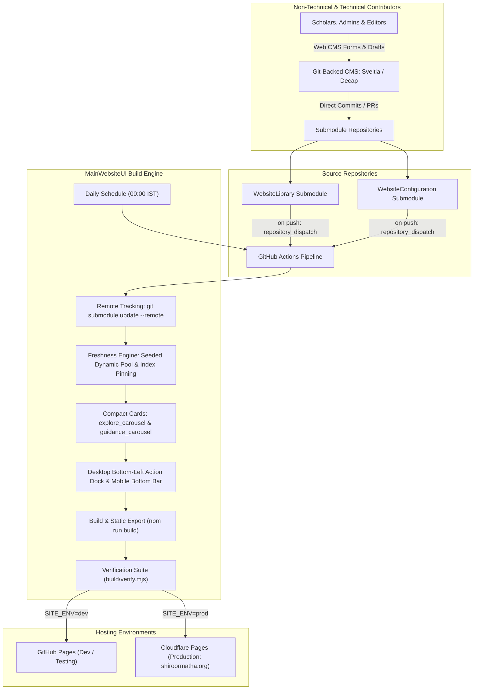

# Architecture

## 1. Purpose and boundaries

This is the multilingual, statically exported website for Shri Shiroor Matha.
Next.js and React provide page structure and interactions; reviewed Markdown,
language JSON, and settings provide visitor-facing content. The deployed application
consists of static files.
External services handle registration, payments, and official communication.

Contributor commands are in [DEVELOPER.md](DEVELOPER.md).

### Architecture Overview



## 2. Source ownership

| Source | Responsibility |
|---|---|
| `src/app/`, `src/components/`, `src/hooks/`, `src/lib/`, `src/context/` | Routes, rendering, interactions, and typed runtime helpers |
| `content/languages/<code>.json` | Language descriptors and short UI labels |
| `library/` | Canonical topic Markdown, devotional corpus, page-reference metadata, and hero configuration |
| `settings/` | Homepage composition, common webpage presentation, navigation, images, theme, search, and interaction behavior |
| `config/site.yml` | Default language, canonical production URL, environment matrix, and verification policy |
| `build/`, `scripts/` | Validation, content generation, export, preview, and output verification |
| `build/test/` | Node unit and regression tests for build tools, content contracts, and runtime behavior |
| `public/` | Tracked static assets |
| `src/gen/` | Disposable generated data, search indexes, and theme output; never edit manually |

`library/` and `settings/` are separate Git submodules. A website commit records their
commit references, not uncommitted files inside them. Publish reviewed submodule
changes before updating the website references.

### Submodule automation and remote tracking

To allow editorial updates in `library/` (articles, events, devotional texts) and `settings/`
(carousels, hero slides, UI configuration) to publish immediately without requiring a
manual bump commit to `MainWebsiteUI`:

1. **Remote-tracking builds**: Continuous integration workflows invoke
   `git submodule update --init --recursive --remote` to check out the current `HEAD` of
   the configured tracking branch (`main`) for each submodule rather than stopping at the
   recorded commit tree reference. Deployment workflows retain deploy key credentials
   across the checkout step to authenticate with private submodule remotes before cleanup.
2. **Repository dispatches**: Upstream push workflows in `WebsiteLibrary` and
   `WebsiteConfiguration` transmit a `repository_dispatch` event (`submodule-updated`)
   to `MainWebsiteUI`, initiating verification, development preview publishing, and
   production deployment automatically.
3. **Non-technical contribution via CMS**: Non-technical authors and temple administrators
   contribute through a browser-based, Git-backed CMS (such as Sveltia CMS or Decap CMS).
   The CMS binds structured form fields directly to Markdown collections in `library/`
   and JSON files in `settings/`. Saving or publishing an entry creates reviewed Git
   commits or pull requests directly in the submodule repositories, triggering the
   dispatch pipeline without requiring Git CLI commands.

### Content is data

Do not hardcode visitor-facing prose or a language list in `src/`. Components obtain
localized content through `useLang()` and generated data. A contributor must be able
to add a language or edit an article without registering it in a component.

Each fact has one canonical owner. Page introductions, metadata, and editorial
sections belong with their topic Markdown, rather than in duplicate UI JSON or
unused Markdown bodies. Short reusable controls belong in language JSON. Homepage
copy and composition belong in settings. Do not invent translations, dates,
contact details, enrollment links, or institutional claims.

The legal and policy documents retain their reviewed wording; changing a layout or
content source is not authorization to rewrite those policies. Preserve applicable
licenses, required attribution, and article citations.

## 3. Languages and editorial content

The generator discovers `content/languages/*.json`; the filename supplies the language
code. `_language` supplies human-readable switcher labels. The default comes from
`site.default_language` in `config/site.yml`, not a hardcoded runtime assumption.
Its optional `font_family` selects a theme font stack for the active script;
the same selection applies to body text, headings, and font utilities. Hero title
maps cover the discovered languages and use the configured default for missing copy.

Missing translated object keys inherit default-language values. Arrays are complete
replacement values, not item-by-item merges. The default language must be complete.
Library translation discovery and fallback follow the same configured language set;
missing translations are not a reason to fabricate a body.
Language, UI settings, and preview preferences are persisted when browser storage is available;
otherwise they remain usable in memory for the current page session.

The Developer options page is exported only for `local` and `dev`. Its localized
entry is appended after the configured menu entries in both real and placeholder
catalogs; it is the last entry in desktop and compact navigation. The page exposes
every supported field in `settings/ui_elements.json` through generated, localized
checkboxes, numeric inputs, and choice controls. Edits remain drafts until **Apply
and reload** validates and saves them. The separate copy checkbox selects
placeholders when checked and real copy when unchecked. Local copy defaults to
real; development copy defaults to placeholders, and copy changes apply immediately.
The page also provides content overrides with two checkboxes per section (one for the
section page & navigation route, and one for section content items), allowing developers
to toggle individual sections and their items independently. Content overrides are stored
under `site-content-overrides`.
Reset restores the configured UI values, content overrides, and environment-default copy,
then reloads, without changing the selected language. If storage is unavailable, Apply and Reset
apply settings in memory and show a warning instead of reloading away those changes.

`build/developer-options.mjs` owns the technical route and storage keys;
`settings/ui_elements.json` owns all UI defaults, including presentation settings
(`tileOverlayOpacity`, `tileCornerRadius`, and `tileMinHeight`).
Copy-preview defaults remain environment-owned.
The page uses `page.preview.tsx`; Next configuration recognizes the `preview.tsx`
extension only in local/dev while retaining all standard page extensions.
Production never registers the route. The page also has a defensive not-found guard.
The utility page is noindex and excluded from the public route inventory and sitemap.
Export verification checks its environment-specific presence separately.
Developer control copy is preserved in placeholder catalogs so controls remain readable.
Production exports neither this page nor its menu entry and always uses real copy,
regardless of the saved copy preference.

`build/ui-settings-schema.mjs` is the shared build/browser validator and field
descriptor source. Generation rejects unknown or invalid settings and missing
localized control labels. Generated raw defaults and normalized aliases feed
`UiSettingsProvider`, which supplies runtime values to every interactive consumer.
The provider's server snapshot always uses configured defaults. When a complete
saved configuration loads or changes, a keyed provider remount initializes
pagination, sort/view/filter state, and reader size from those settings.

The browser stores a complete validated raw configuration as JSON in
`site-ui-settings` in per-origin `localStorage`. Invalid saved data produces a
warning and falls back to configured defaults. The browser-only compatibility
validator accepts older complete configurations missing `tileOverlayOpacity`,
`tileCornerRadius`, `tileMinHeight`, and/or obsolete keys, inheriting those values
from current defaults without losing existing choices.
Build-time settings remain strict.
The standalone generated hero embeds the same validator and defaults,
applies presentation/autoplay/interval/fade settings, and follows cross-document storage
events. Production supports all browser-local UI overrides without exposing a
developer page or enabling placeholder catalogs. These preferences are not runtime
environment variables, secrets, or an authorization mechanism.

The final homepage guidance group omits the temporary-content footer and its
separator in every layout mode; other homepage grids retain configured footnotes.
`presentation.tileMinHeight` controls the minimum height of collection tiles through
`--tile-min-height`, defaulting to 360px.
`presentation.tileCornerRadius` independently controls shared collection-card and
homepage photographic-card corners through `--tile-corner-radius`. Its default
20px preserves the existing shape; integers from 0 to 48 are accepted, with 0
making square corners. The `collection-tile` marker also covers event cards without
changing their image/text treatment. Hero banners share the value only on their
bottom corners, including the generated standalone hero; top corners stay square.
Shortcut icons, dialogs, and full-screen playback do not opt in.

Structured page copy uses multilingual frontmatter, for example:

```yaml
---
kind: localized-copy
fields:
  pages.example.title:
    en: Example title
---
```

The dotted field names are the generated dictionary contract. Copy belongs in the
appropriate `library/<topic>/` source, not simultaneously in its frontmatter, body,
and language JSON. Active shared control and editorial namespaces are `ui` and
`editorial`.

### Canonical collections

| Collection | Canonical source and important rules |
|---|---|
| Bhakti | `library/dasasahitya/*.md`; preserve source identifiers, attribution, and verse layout |
| Sevas | `library/sevas/*.md`; localized offerings and language-specific guideline bodies |
| Material enquiries | `library/donations/pages/donation.md`; one localized catalog preserving the selected material names and prices |
| Events | `library/events/`; validated calendar dates and metadata drive catalog/detail pages; malformed records fail generation |
| Guru Parampara | `library/parampara/`; numeric filename prefixes determine order; metadata supports bilingual fields (`position`, `name-en`, `name-kn`, `summary-en`, `summary-kn`, `timePeriod-en`, `timePeriod-kn`, `shaka`, `samvatsara`, `aradhana`, `vrindavanaKshetra`) and localized details; translations inherit missing optional facts |
| Mathas & Deities | `library/mathas/` and `library/deities/`; numeric filename prefixes determine order; metadata supports bilingual titles, subtitles, eras/attributes, and markdown details for the Know the Story tabs |
| Learn | `library/learn/index.md` and subject Markdown; collection order, page labels, suggested paths, and subject metadata live together |
| Branches and official channels | `library/branches/` and `library/connect/`; generated data supplies locations and shared official destinations |
| Institutional and policy pages | Corresponding topic Markdown, including `library/general/` |
| Announcement | `library/announcement/krishna-mantra-lekhana-yajna.md`; one owner for popup, associated page copy, and metadata |
| Media Albums | `library/albums/*.md`; responsive 4-variant image lists, optional event references, and dynamic ranking via `settings/album_config.json` |
| Knowledge sections | Topic Markdown in `library/mantra/`, `shastra/`, `jnana/`, `dharma/`, `projects/`, `stories/`, `articles/`, `symbolism/`, `remedies/`, `science/`, and `pilgrim/` |

Knowledge section routes and supported IDs are defined in
`build/library-sections.config.mjs`. Display order comes from
`settings/knowledge_sections.json`, while section cover images, titles, and introductory
copy are consolidated directly into their corresponding page-reference records in
`library/pages/*.md` (merging previous section metadata into page references).
All Markdown documents across `library/` support an explicit `enabled: boolean`
frontmatter flag (defaults to `false` if omitted; set to `true` to enable). In `dev`
and `local` builds, section definitions and their child articles export with an `enabled`
flag into `src/gen/library/data.ts`, with section routes and navigation conditionally
honoring content availability. Section-specific schemas validate
metadata such as project status or verified outcomes; use existing records and
`build/knowledge-schema.mjs` as the field reference. Collection index documents are
not ordinary articles.

Markdown is rendered with raw HTML disabled and sanitized before use. Source IDs,
required default-language content, metadata types, and safe paths are validated at
generation time. Authored knowledge/review status must remain visible to readers;
sample or unreviewed content must not appear to be verified institutional guidance.

### Dated and temporary information

The Yajna progress figures are an authored snapshot.
Update the count and `pages.local_copy.yajna_as_of_date` together in the announcement
Markdown. The date must be valid and identical across translations; rebuilding must
not substitute today's date. Panchanga currently carries a temporary test-data note.
Its localized `panchanga_notice` belongs in Panchanga topic Markdown. Keep that
limitation visible until verified production data replaces it. Project collections
show editorial article status separately from operational project status; related
cards retain authored status, and homepage remedy footnotes expose it too.

## 4. Homepage and navigation

`settings/home.json` configures the homepage composition, including `top_carousel`,
`icon_carousel`, `bottom_carousel`, and compact dynamic showcases. Card titles,
descriptions, images, types, destinations, and footnotes belong in their canonical
Markdown records, rather than repeated in settings.
If a referenced page is disabled (either via authored `enabled: false` or via Developer Options),
its corresponding tile across `top_carousel`, `icon_carousel`, `bottom_carousel`, `explore_carousel`,
`guidance_carousel`, or hero slides is disabled/hidden. Enabling the section in Developer Options
dynamically re-enables its tiles.

### Dynamic Freshness Engine and Index Pinning

Carousels on the homepage (`top_carousel`, `bottom_carousel`, `explore_carousel`, and hero slides)
support dynamic daily rotation alongside deterministic index-specific pinning:

1. **Configurable Structure**: Settings can be authored either as simple lists of Markdown
   filenames or as dynamic rotation objects declaring a `count`, a candidate `pool`,
   explicit `pinned` items, and calendar `overrides`:
   ```json
   {
     "count": 6,
     "pinned": [
       { "index": 0, "item": "events.md" },
       { "index": 3, "item": "sevas.md" }
     ],
     "pool": [
       "projects.md", "story.md", "history--parampara.md",
       "albums.md", "volunteer.md", "krishna-mantra-yajna.md"
     ],
     "overrides": [
       {
         "date": "2026-08-25",
         "pinned": [
           { "index": 0, "item": "festival-krishna-janmashtami.md" }
         ]
       }
     ]
   }
   ```
2. **Specific Index Pinning**: Items can be pinned to exact target positions (e.g., slot 0
   or slot 3). During build generation, pinned slots are filled first.
3. **Daily Seeded Selection**: Remaining unpinned slots are filled from `pool` using a
   pseudo-random shuffle deterministically seeded by the build date (`YYYY-MM-DD`). This
   ensures all daily visitors receive an identical curated view, while daily builds
   automatically rotate fresh content without manual commits.
4. **Calendar Overrides**: Date-specific or range-based (`startsOn` to `endsOn`) override
   blocks take precedence on matching days, pinning festival or occasion-specific pages
   to their designated indices.

### Compact Showcases: Explore and Guidance Carousels

`explore_carousel` and `guidance_carousel` (Guidance) present individual library items
(drawn from across all knowledge topics, remedies, and sevas) using a compact, image-free layout:

* **Text-Focused Density**: Unlike collection tiles, compact cards omit thumbnail images
  and display only the topic badge (`page_type`), bilingual title, and 2-line summary.
* **Full-Surface Navigation**: The entire card surface serves as the clickable link;
  redundant standalone arrow icons or links are intentionally omitted.
* **Corpus Sampling**: Content generation draws from all eligible Markdown articles across
  `library/` (e.g. hymns, philosophy, pilgrim guides, remedies, and sevas), allowing
  specific devotional or educational pieces to be showcased directly on the homepage.

### Responsive Action Navigation: Mobile Bar and Desktop Floating Dock

The five `icon_carousel` links adapt to viewport size:

* **Mobile and Tablet (`xl:hidden`)**: A fixed bottom navigation dock with equal-width
  grid columns (`fixed bottom-0 inset-x-0`), touch-friendly 44px–54px rounded icon tiles,
  and localized labels below each icon.
* **Desktop (`hidden xl:flex`)**: A compact, floating vertical action dock pinned to the
  **bottom-left edge** (`fixed bottom-6 left-6 z-40`). Styled as an elevated translucent
  card (`bg-[var(--color-cream-card)]/90 backdrop-blur-md border border-[var(--color-line)]`),
  icons scale on hover and reveal accessible flyout title tooltips to the right without
  cluttering the main header or obscuring the bottom-right announcement widget.

The six-card `bottom_carousel` remains a separate collection.

The generated `guidance_carousel` contains distinct guidance items drawn from
`library/sevas/` and `library/remedies/` per content generation. Selection is shared by all languages and
content variants for that generation, supporting count, slot pinning, and date overrides. When guidance or its items are
disabled, the guidance section and its tiles are hidden.

Hero carousel slides live in individual Markdown files under `library/hero/*.md`, with presentation order defined by `settings/home.json` under `"hero"`.
Slides whose target destinations point to disabled pages/routes are conditionally hidden,
reappearing when the target section is enabled in Developer Options. Preserve image resolution and controls.

`settings/navigation.json` owns menus, route destinations, footer policy links, and
official social `connectId` references. Labels are localized separately. Only concrete
active routes belong in page references, navigation, and sitemaps; a metadata record
does not create a route.

Compact navigation serves widths below `80rem`, including intermediate
tablet/small-laptop widths; full navigation and its utility bar start at `80rem`.
Menu groups
support touch/click and keyboard disclosure, expose their expanded state, and close
on Escape. Crossing into full navigation closes an open compact menu and releases
its scroll lock.

Learn and Panchanga use server route wrappers for content-owned metadata and client
components for language-aware interactions. Each Learn subject supplies its own
title and description rather than inheriting homepage metadata. Root layout
configures canonical and bilingual `hreflang` alternate URLs, Open Graph and Twitter
card metadata, preconnects to remote image CDN origins, and injects Schema.org
JSON-LD structured data (`HinduTemple`, `Organization`, `WebSite`) via
`src/components/StructuredData.tsx`.

App and generated pages (all routes except the home page) provide top back navigation
via `src/components/BackNavigation.tsx` mounted in the root layout. It provides a
localized back action that uses in-site browser history when available, falling back
to the logical parent route computed by `src/lib/back-navigation.ts`.

## 5. Images, media, and interactions

Images are configured as direct HTTPS targets in content Markdown and settings JSON.
`build/image-resolution.mjs` is the shared resolution rule:

- An absolute HTTPS target bypasses the media base.
- A relative target is appended to the configured media-directory base, including
  when it begins with `/`. It does not replace the base directory.
- Unsafe schemes, traversal, credentials, and malformed targets are rejected.

`settings/image_policy.json` separately controls framework image optimization and
allowed remote hosts. `settings/common.json` owns shared webpage presentation defaults:
fixed unscrollable full-page background images positioned behind main content, font
family stacks (`fontFamily`), and the uniform semantic font size scale (`fontSize`:
`micro`, `caption`, `ui`, `nav`, `body`, `badge`, `formLabel`, `formInput`,
`actionButton`, `meta`), which the root layout injects as `--font-*` and `--text-*`
CSS custom properties consumed by utility classes in `src/app/globals.css`.
`settings/theme.json` owns color, spacing, radius, and shadow tokens; the generator emits
`src/gen/settings/theme.css`. Layout and responsive behavior remain source code.
Category tones share semantic mappings across event rails, lists, and badges.
Content photographs, posters, portraits, and thumbnails use
`src/components/presentation/ContentImage.tsx`. By default, foreground images cover
their frames and the decorative layer is hidden. Enabling the browser-local image
option contains the sharp foreground over a statically blurred and darkened copy
of the same source; foreground padding preserves image edges inside rounded frames.
By default, captions, badges, and navigation controls
sit outside the artwork; foreground images do not zoom. Natural-size annotated
illustrations retain their image-relative annotation coordinates. Logos, QR codes,
functional icons (including failed-image placeholders), and full-screen album playback
retain their own presentation.
The hero title is always overlaid on its image, independently of the tile option,
using warm-white text with text shadow and an upward gradient shadow from the bottom
for high-contrast legibility over light artwork (without a solid background panel). The standalone
generated hero mirrors that overlay and the preference-gated two-layer image treatment.
Shared featured/collection presentation variants preserve their distinct layouts
while keeping spacing, controls, focus, and result states consistent. Policy text
uses a readable shared size; utility controls have touch-friendly targets.

Photographic cards use an image-backed presentation with `visual-tile`,
`visual-tile-art`, and `visual-tile-body` hooks. Their images fill the tile behind a
lightly darkened text panel with a fade above the text, using the complete-image
contain/blur treatment. Foreground images align top-centre.
Text shadows aid readability, but contrast remains image-dependent with this
deliberately translucent treatment.
`presentation.tileOverlayOpacity` controls panel opacity from 0 to 100 percent
(default 40), through the root `--tile-overlay-opacity` custom property. It never
changes hero text or image opacity. Titles wrap without line clamping,
and cards grow for translated text. Stretched detail links and separate actions
retain their original positioning and keyboard behavior.
Home photo tiles, section hubs, library previews, seva and learning cards,
album covers/items, and illustrated lineage entries participate. Event poster
surfaces, detail views, full-screen album playback, and icon-only tiles do not.
The hero's overlay is always enabled.
Forced-color mode uses system text/panel colors.

Media albums are built from language catalog data. Use stable explicit IDs
and valid image/video metadata; do not infer publication rights from remote availability.

`settings/ui_elements.json` supplies collection pagination, reader controls, viewer
boundaries, default filters/sorting, upcoming-event limits, slideshow timing,
interaction delays, presentation flags, and horizontal auto-scroll behavior.
The obsolete `hero.zoomDurationMs` option is unsupported; foreground images do not
zoom. `searchPreloadDelayMs` is the fallback preload delay when idle callbacks are
unavailable. Reading-speed overrides affect estimates, not authored reading times.
Horizontal rails preserve
manual touch scrolling, desktop dragging, interaction pause/resume, and reduced-motion
preferences. Turning autoplay off does not disable manual navigation. Runtime callers
use the shared settings-aware scroll API.
Rails suspend animation work when movement is unavailable, recover from canceled
touches, and preserve manual input. Decorative loops stop under reduced motion.
Hero autoplay has a separate pause/resume control and responds to motion-preference
changes while the page is open.

Dialogs own focus, restore it on close, and keep controls reachable in short
viewports through constrained panels and scrollable content. Photo viewing permits
pinch zoom without treating multi-touch as item navigation. Reader transitions move
focus into the reading view and restore it to the originating result on return.
Announcements remain visually on top during normal browsing, are temporarily hidden
while a dialog is open, and return afterward unless dismissed.
Dialog and menu scroll locks are reference-counted so closing one overlay cannot
release another overlay's active lock.

Search uses MiniSearch with generated indexes and runtime loading where appropriate.
`settings/search.json` supplies matching options and collection field weights.
Content, generated indexes, and runtime searches must use the same configuration.
Runtime indexes follow the active catalog; switching copy mode invalidates stale
indexes and ignores asynchronous completions for the previous catalog.

## 6. Environments

`config/site.yml` is authoritative:

| Environment | Base path | Content | Indexing |
|---|---|---|---|
| `local` | Site root | Switchable real/placeholder copy | Disabled |
| `dev` | `/MainWebsiteUI` | Switchable; exported default is placeholder | Disabled |
| `prod` | Site root | Real copy | Enabled |

The environment is selected by the build argument, then `SITE_ENV`, then `dev`.
Internal links and static assets honor the configured base path.

Switchable previews include both copy variants in public assets. Placeholder output
and `noindex` are testing/search controls, not confidentiality boundaries. Production
canonical URLs use `site.production_url`; maintainers must verify DNS, HTTPS, and the
hosting custom-domain binding before launch.

Development/local synthetic event copies are controlled by
`settings/dev/synthetic_events.json`. Originals remain unchanged, and production does
not generate synthetic copies.

## 7. Build and deployment

`package.json` declares dependencies as an ES module (`"type": "module"`) and `package-lock.json` records their resolved
versions for `npm ci`. Next.js and its ESLint configuration use matching stable
versions.

The deployment entry point is `build/build.mjs`. It cleans generated output, builds
theme/settings, media, Bhakti, Sevas, Events, and knowledge sections, generates the
remaining website content, runs Next's static export, normalizes canonical URLs, and
verifies the result. Shared preparation includes theme generation for local
development as well as builds. Test entry points prepare required generated content;
CI can reuse preparation across lint, type checking, and tests while full environment
builds remain independent. `next.config.ts` enables static export. The deployment
entry point selects Webpack with `next build --webpack` for every export environment.
`scripts/patch-next-font.mjs` applies a fallback for Google Fonts URLs without explicit
file extensions in `@next/font` during postinstall and build entry points.

The exported site is written to `out/`. Only one environment's export occupies that
directory at a time. `npm start -- dev|local|prod` (choose one environment) serves the
matching existing export with its configured mount path; it does not regenerate
content. Selection defaults to `SITE_ENV`, then `dev`. Preview validates exported
asset base paths, serves clean exported HTML routes and assets, and returns real
404 responses without a single-page-app fallback. Next's flattened segment-prefetch
URLs are mapped to their existing nested export files so client navigation can load
its static payloads. It binds to localhost:3000 unless
`PORT` is set.

Development, generation, cleaning, and full builds coordinate ownership of shared
workspace output. Do not run a build or cleanup against a workspace serving active
development; stop that server first. Separate checkouts can run independently.
Ownership is recorded in `node_modules/.cache/website-tooling.lock`, inherited by
authorized generator subprocesses, and reclaimed when its owner is no longer alive.
Next's own development/build locks also block writes by the tooling entry points.
`npm run check` prepares content once before lint, type checking, and unit tests.

Verification checks exported HTML and the manifest for detectable real-content leaks
when placeholders are the default, checks routing/metadata expectations, and fails
the build on configured violations. Exact default-language prose of at least 30
characters and configured brand terms are detectable; short, altered, or non-default
language literals can escape that check. Review source for display strings too.
Sitemap verification compares exact canonical route membership and rejects duplicate,
missing, and unexpected URLs rather than relying only on a URL count.

GitHub workflows verify pull requests and `main`; the development workflow publishes
the reviewed `main` export to GitHub Pages. The production configuration targets a
root-hosted static site. Deployment credentials and hosting setup are operational
concerns, not visitor-facing settings.

### Automated Production Deployment to Cloudflare Pages

Production hosting for `shiroormatha.org` is provided by Cloudflare Pages:

1. **Dual-Environment Pipeline**:
   * **Development (`SITE_ENV=dev`)**: Automatically built and published to GitHub Pages
     on push to `main` and daily schedule for preview and QA testing.
   * **Production (`SITE_ENV=prod`)**: Built using `node build/build.mjs prod` (invoked via
     `npm run build:prod`) with canonical production URLs, enabled indexing, and real
     authored copy. Static files in `out/` are uploaded to Cloudflare Pages via GitHub Actions
     (`cloudflare/pages-action` or Wrangler).
2. **Triggering Mechanisms**:
   * **Submodule Dispatches**: Upstream changes in `WebsiteLibrary` or `WebsiteConfiguration`
     emit `repository_dispatch` triggers (`submodule-updated`) to deploy updated content
     instantly.
   * **Daily Automated Midnight Refresh**: Scheduled GitHub Actions run daily at 00:00 IST
     (`0 21 * * *` UTC), refreshing date-sensitive event partitions, seeded carousel pools,
     and holiday overrides without requiring manual commits.
   * **Manual Promotion**: Authorized maintainers can run `workflow_dispatch` with an optional
     target environment input.

A passing working-directory build is not sufficient evidence for CI: required files
must be tracked and submodule commits available to the checkout. The clean-checkout
procedure is in the Developer Guide.

## 8. Official actions and trust boundaries

`settings/public_actions.json` owns public action destinations. Its `connectId`
references resolve to canonical `library/connect/` records. Do not invent destinations
inside components.

The payment QR is generated at build time from the configured payment destination.
Preserve the complete URL and its query parameters. External services handle payment
processing and confirmation.

Material enquiries use the localized catalog in
`library/donations/pages/donation.md` and the configured email destination.
Display only real submission/contact capabilities; do not show a successful
registration or enquiry when nothing was sent.

The official WhatsApp record is a **broadcast channel**, not a direct-message inbox.
Use it for following announcements, not for prefilled private enquiries or promised
message delivery.
Public configuration must never contain credentials.

## 9. Maintenance

Update this guide when ownership, structure, environments, or the pipeline changes.
Update the Developer Guide when contributor steps change. Keep tests and validation
at the layer that owns the behavior. Document existing behavior and explicit
restrictions. Exclude migration narratives, removed or unimplemented features,
historical implementation notes, and duplicated configuration values.
