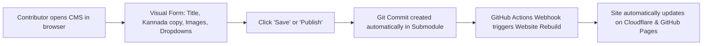

# Non-Technical Content Contribution Guide

This guide describes how non-technical scholars, administrators, and volunteers contribute to Shri Shiroor Matha's website content and configuration without using Git commands or terminals.

---

## 1. How It Works

The website uses a Git-backed CMS (**Sveltia CMS** / **Decap CMS**).
The CMS runs directly in the web browser and connects to the GitHub repository using secure authentication.



1. Contributors log in at the CMS URL on GitHub Pages / testing site (`https://vedavardhanatheertha.github.io/MainWebsiteUI/contribute/`) or on the custom production domain (`https://shiroormatha.org/contribute/`).
2. They select a topic (e.g., *Devotional Songs*, *Events*, *Pilgrim Guide*, or *Homepage Settings*).
3. They fill in friendly form fields (bilingual text, date pickers, category dropdowns, image uploaders).
4. When they click **Save** or **Publish**, the CMS commits the changes directly to `WebsiteLibrary` or `WebsiteConfiguration`.
5. The commit automatically triggers the website's GitHub Actions workflow via `repository_dispatch`, rebuilding and publishing the live site within minutes.

---

## 2. Managing Library Content

The CMS organizes `library/` into visual collections:

| Collection | Folder | Available Fields |
| :--- | :--- | :--- |
| **Events** | `library/events/` | Title (EN/KN), Start/End Dates, Start/End Times, Display Date, Location, Performers, Categories, Description, Program Details, Poster Image |
| **Devotional Songs (Bhakti)** | `library/dasasahitya/` | Song Title (EN/KN), Composer (Devara Nama / Haridasa), Deities, Raga, Tala, Kannada Lyrics, English Transliteration/Translation |
| **Pilgrim Guide** | `library/pilgrim/` | Title, Timings, Guidelines, Dress Code, Darshana Tips, Contact/Helpdesk info |
| **Remedies & Guidance** | `library/remedies/` | Remedy Name, Astrological/Spiritual Concern, Recommended Stotras/Pooja, Status, Summary |
| **Stories & Philosophy** | `library/stories/`, `library/shastra/` | Title, Chapter/Source, Main Narrative, Philosophical Commentary, Target Audience |
| **Sevas & Poojas** | `library/sevas/` | Seva Title, Deity, Suggested Contribution Amount, Frequency, Description |

---

## 3. Managing Homepage Settings (`settings/home.json`)

Non-technical administrators can adjust homepage carousels, slide ordering, and event overrides through visual file collections:

### A. Homepage Carousel Settings (`settings/home.json`)
The CMS provides form controls to:
* **Pin items to specific slots**: Select an article and specify its exact index (e.g., slot 0 for upcoming Rathotsava).
* **Choose a dynamic candidate pool**: Select which articles or sections should rotate automatically.
* **Set temporary holiday/event overrides**:
  * Set a specific date (`2026-08-25`) or date range (`startsOn: 2026-01-10`, `endsOn: 2026-01-20`).
  * Choose which items appear during that festival window.

### B. Hero Carousel Banner (`settings/home.json` -> `hero`)
* Drag and drop default slides to re-order them.
* Add festival banners with active date windows. On matching days, the festival slide automatically leads the homepage.

---

## 4. In-Repo CMS Configuration (`public/contribute/config.yml`)

The live contributor portal is served directly from `/contribute/` (`public/contribute/index.html` and `public/contribute/config.yml`). Non-technical contributors can access it at:
* **Development / Staging**: `https://vedavardhanatheertha.github.io/MainWebsiteUI/contribute/`
* **Production**: `https://shiroormatha.org/contribute/`
* **Volunteer Page Link**: Accessible directly from the Volunteer page at `/volunteer`.

```yaml
backend:
  name: github
  repo: VedavardhanaTheertha/WebsiteLibrary
  branch: main

media_folder: "public/images/uploads"
public_folder: "/images/uploads"

collections:
  - name: "events"
    label: "Events & Festivals"
    folder: "events"
    create: true
    slug: "{{slug}}"
    format: "frontmatter"
    fields:
      - { label: "Slug / Filename", name: "slug", widget: "string" }
      - { label: "Title (English)", name: "title_en", widget: "string" }
      - { label: "Title (Kannada)", name: "title_kn", widget: "string" }
      - { label: "Start Date", name: "start_date", widget: "datetime", date_format: "YYYY-MM-DD", time_format: false }
      - { label: "End Date", name: "end_date", widget: "datetime", date_format: "YYYY-MM-DD", time_format: false, required: false }
      - { label: "Display Date (English)", name: "display_date_en", widget: "string" }
      - { label: "Display Date (Kannada)", name: "display_date_kn", widget: "string" }
      - { label: "Location", name: "location_en", widget: "string", default: "Udupi Sri Krishna Matha" }
      - { label: "Image", name: "image", widget: "image", required: false }
      - { label: "Enabled", name: "enabled", widget: "boolean", default: true }
      - { label: "Description (English)", name: "description_en", widget: "text" }
      - { label: "Description (Kannada)", name: "description_kn", widget: "text" }
      - { label: "Body", name: "body", widget: "markdown" }

  - name: "remedies"
    label: "Remedies & Guidance"
    folder: "remedies"
    create: true
    slug: "{{slug}}"
    format: "frontmatter"
    fields:
      - { label: "ID", name: "id", widget: "string" }
      - { label: "Title (English)", name: "title.en", widget: "string" }
      - { label: "Title (Kannada)", name: "title.kn", widget: "string" }
      - { label: "Summary (English)", name: "summary.en", widget: "text" }
      - { label: "Summary (Kannada)", name: "summary.kn", widget: "text" }
      - { label: "Status (English)", name: "status.en", widget: "string", default: "Reviewed" }
      - { label: "Status (Kannada)", name: "status.kn", widget: "string", default: "ಪರಿಶೀಲಿಸಲಾಗಿದೆ" }
      - { label: "Enabled", name: "enabled", widget: "boolean", default: true }
      - { label: "Content", name: "body", widget: "markdown" }
```

---

## 5. Review & Approval Workflow

For quality assurance and editorial review:
1. **Draft Mode**: Contributors can save their work as "Draft". Behind the scenes, the CMS creates a Git branch and Pull Request instead of committing directly to `main`.
2. **Preview**: Reviewers can preview the article on the staging environment.
3. **Approval**: An authorized editor clicks **Publish** in the CMS, which merges the Pull Request and triggers the automated deployment pipeline to live production.
